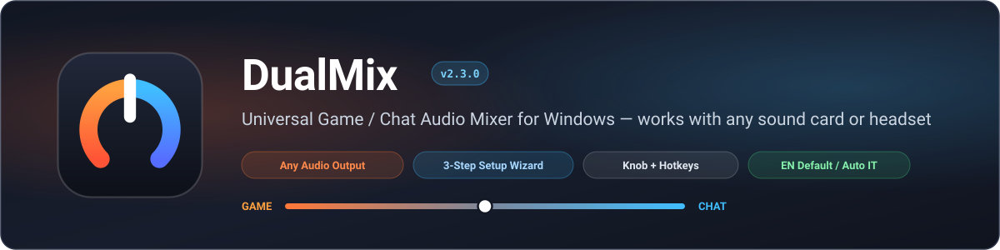
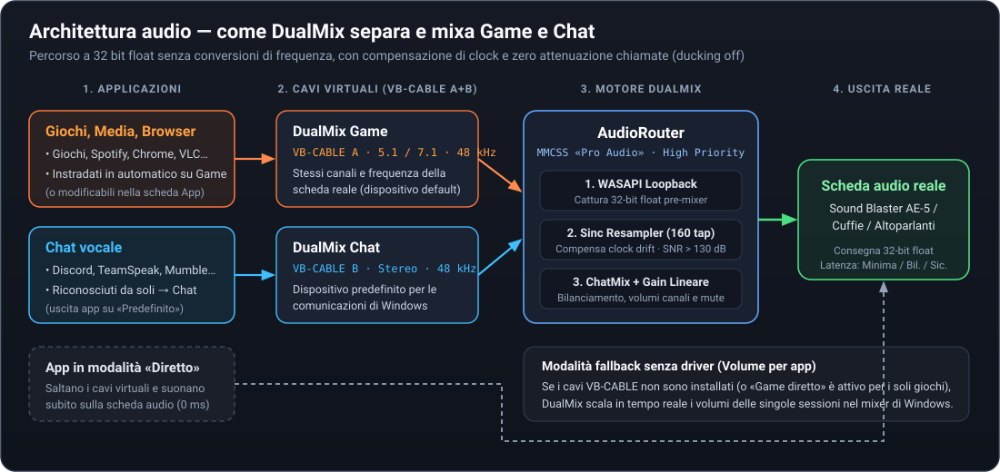
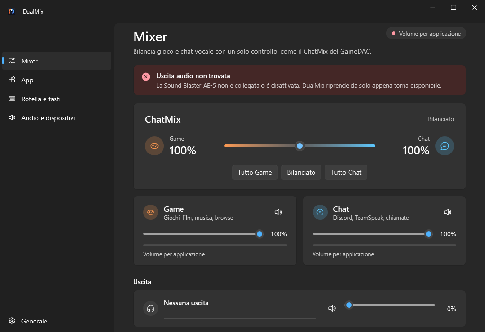
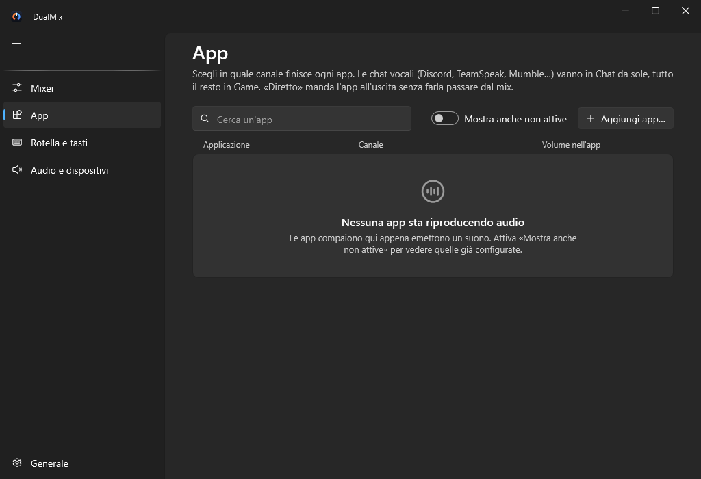
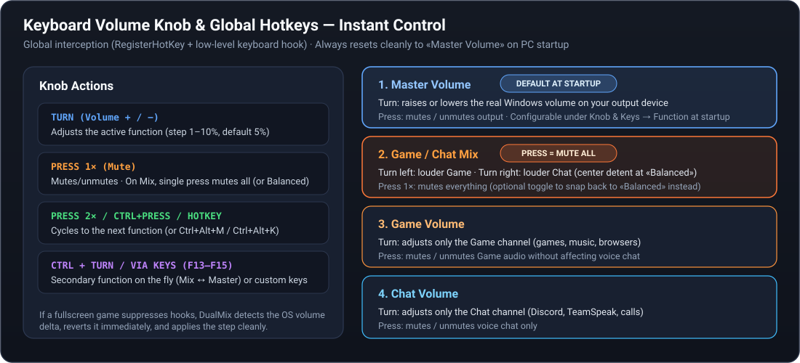
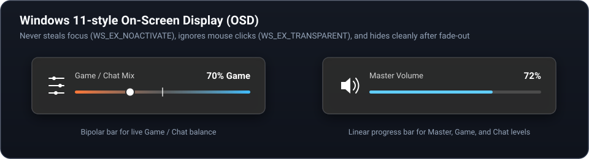
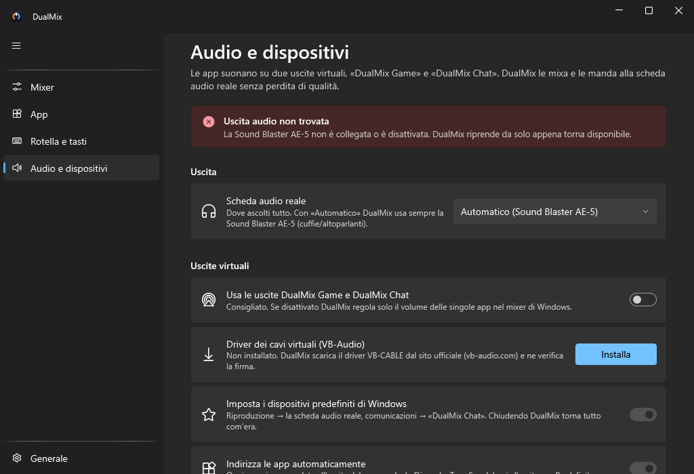
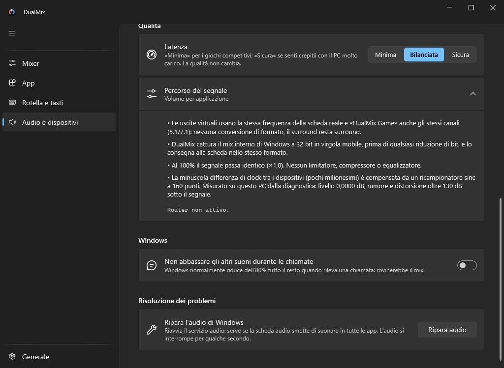
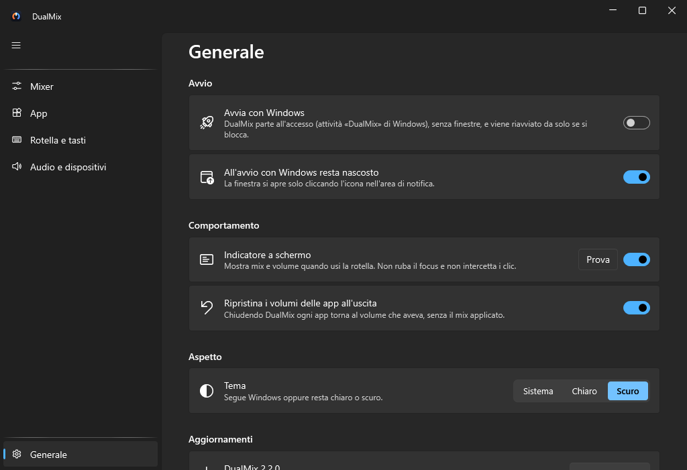
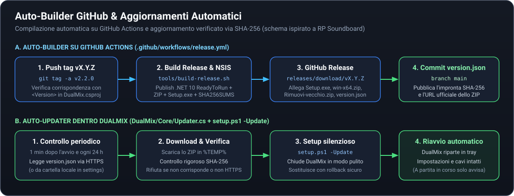

<p align="center">
  
</p>

<p align="center">
  <a href="https://github.com/gamebaiters/dualmix/releases"></a>
  <a href="https://github.com/gamebaiters/dualmix/actions/workflows/build.yml"></a>
  
  
  <a href="LICENSE"></a>
</p>

**DualMix** è un mixer audio Game/Chat per **Windows 11** ispirato al *ChatMix* di SteelSeries Sonar / GameDAC.
Separa automaticamente l'audio dei giochi, browser e musica (**Game**) da quello di Discord, TeamSpeak e chiamate (**Chat**), permettendoti di bilanciarli al volo con la **rotella della tastiera** o con scorciatoie globali, senza mai uscire dal gioco.

---

## Come funziona

DualMix indirizza le applicazioni su due uscite virtuali (**DualMix Game** e **DualMix Chat**), cattura entrambi i flussi in virgola mobile a 32 bit tramite **WASAPI Loopback**, compensa la deriva di clock tra i dispositivi con un **ricampionatore sinc a 160 punti** (SNR > 130 dB, bit-exact a 100%) e li mixa verso la tua scheda audio reale. Se i cavi virtuali non sono installati, passa automaticamente alla modalità **Volume per app** sul mixer di Windows.

<p align="center">
  
</p>

---

## Installazione

Scarica l'ultima versione dalla pagina [**Releases**](https://github.com/gamebaiters/dualmix/releases/latest):

1. **Installer grafico (`DualMix-Setup-<v>.exe`)** — doppio clic e via. Non richiede diritti di amministratore.
2. **Pacchetto portatile ZIP (`DualMix-<v>-win-x64.zip`)** — estrai la cartella ed esegui **`Installa DualMix.cmd`** (utile se Windows SmartScreen o l'antivirus trattengono l'`.exe` non firmato; esegue esattamente gli stessi passaggi).

Cosa fa il setup (`packaging/setup/setup.ps1`):
- Scarica e installa automaticamente il runtime **.NET 10 Desktop** (solo per l'utente corrente) se manca sul PC.
- Chiude in modo pulito un'eventuale istanza già attiva e rimuove vecchie installazioni manuali precedenti alla v2.2.0, **conservando impostazioni e driver virtuali**.
- Installa in `%LOCALAPPDATA%\Programs\DualMix`, crea il collegamento nel menu Start e la voce in **App installate** di Windows, poi avvia DualMix nell'area di notifica.
- Registra ogni passaggio in `%APPDATA%\DualMix\setup.log`.

| Utilità | Scopo |
|---|---|
| **`Rimuovi-vecchio-DualMix.zip`** → `Rimuovi vecchio DualMix.cmd` | Rimuove soltanto una vecchia installazione manuale di DualMix (fino alla 2.1.0), lasciando impostazioni e cavi intatti. |
| **`Disinstalla DualMix.cmd`** (o *Impostazioni → App → DualMix*) | Disinstallazione completa. Supporta `-RemoveDrivers` (toglie anche i cavi virtuali) e `-Purge` (cancella anche impostazioni e log). |

---

## L'interfaccia

### 1. Mixer
Il cuore dell'app: cursore **ChatMix** con preset rapidi (*Tutto Game*, *Bilanciato*, *Tutto Chat*), volumi e indicatori live (meter) separati per **Game** e **Chat**, controllo diretto della scheda audio reale e chip di stato del motore audio.

<p align="center">
  
</p>

### 2. App — Assegnazione automatica dei canali
Le app compaiono appena riproducono audio:
- **Chat vocali** (`Discord`, `TeamSpeak`, `Mumble`…) vengono riconosciute e assegnate automaticamente a **Chat**.
- Tutto il resto (giochi, browser, player musicali) va in **Game**.
- Puoi spostare qualsiasi app in **Game**, **Chat** o **Diretto** (bypassa i cavi virtuali e suona dritto sulla scheda audio a latenza zero), cercare nella lista, mostrare app non attive o pre-configurare un eseguibile prima ancora che suoni.

<p align="center">
  
</p>

---

## Rotella della tastiera, Scorciatoie e OSD

DualMix intercetta i tasti multimediali della tastiera (`Volume +`, `Volume −`, `Muto`, es. manopola del NuPhy Kick75 o di qualsiasi tastiera) tramite `RegisterHotKey` + hook a basso livello, e corregge eventuali cambi di volume sfuggiti a Windows anche con giochi a schermo intero.

<p align="center">
  
</p>

| Funzione | Rotazione | Pressione singola |
|---|---|---|
| **Volume generale** *(predefinita a ogni avvio)* | Regola il volume reale di Windows sulla scheda audio | Muto / Riattiva uscita |
| **Mix Game/Chat** | Sinistra → più Game · Destra → più Chat *(si ferma al centro su Bilanciato)* | **Muto di tutto** *(opzione: torna a Bilanciato)* |
| **Volume Game** | Regola solo il livello del canale Game | Muto / Riattiva Game |
| **Volume Chat** | Regola solo il livello del canale Chat | Muto / Riattiva Chat |

- **Cambio funzione al volo**: doppia pressione della rotella, **Ctrl + pressione**, oppure scorciatoia da tastiera (`Ctrl + Alt + M`, con ripiego automatico su `K`, `R`, `F12` se già occupata).
- **Ctrl + gira**: controlla temporaneamente l'altra funzione principale (*Mix* ↔ *Volume generale*).
- **Tasti dedicati (VIA / QMK)**: puoi associare `F13`, `F14`, `F15` a *più Game*, *più Chat* e *Bilanciato* per averli sempre pronti.
- **Funzione all'avvio**: per impostazione predefinita a ogni accensione del PC la rotella riparte da **Volume generale** (puoi cambiare in *Rotella e tasti → Comportamento → Funzione all'avvio*).

<p align="center">
  
  
</p>

### Indicatore a schermo (OSD)
Quando giri o premi la rotella compare un piccolo riquadro in stile Windows 11 sul monitor del gioco attivo:
- **`WS_EX_NOACTIVATE` + `WS_EX_TRANSPARENT`**: non ruba mai il focus e ignora i clic del mouse.
- **Chiusura pulita**: a fine dissolvenza la finestra viene nascosta davvero (con timer di sicurezza e reazione ai cambi di schermo) per evitare artefatti o sfondi residui sopra i giochi.

<p align="center">
  
</p>

---

## Audio, Cavi virtuali e Qualità

- **Scheda audio reale**: scelta automatica o manuale dell'uscita fisica (mai un cavo virtuale, per evitare loop).
- **Driver VB-Audio**: usa **VB-CABLE A+B** (`DualMix Game` in 5.1/7.1 a 48 kHz 24-bit e `DualMix Chat` in stereo), oppure installa/ripara il driver verificandone la firma digitale.
- **Latenza**: *Minima* (gaming competitivo), *Bilanciata* (predefinita), *Sicura* (sistemi sotto carico); opzione **Game diretto** per azzerare la latenza dei soli giochi mantenendo comunque il bilanciamento per sessione.
- **Zero attenuazione chiamate**: disattiva l'abbassamento automatico dell'80% applicato da Windows durante le chiamate VoIP.
- **Ripara audio**: riavvia in sicurezza i servizi audio di Windows in caso di blocco della scheda audio.

<p align="center">
  
  
</p>

---

## Avvio, Diagnostica e Aggiornamenti Automatici

DualMix gira senza finestre né console visibili dentro l'host `.NET` (`conhost.exe --headless dotnet.exe DualMix.dll --supervise --tray`), con un supervisore che lo riavvia automaticamente in caso di arresto anomalo.

<p align="center">
  
  
</p>

### Come funzionano gli aggiornamenti e l'Auto-Builder

Il sistema di aggiornamento segue lo schema di **RP Soundboard**: un piccolo documento `version.json` sul branch `main` indica l'ultima versione, l'URL HTTPS dello ZIP di rilascio e l'impronta **SHA-256**.

<p align="center">
  
</p>

- **Controllo**: 1 minuto dopo l'avvio e poi una volta ogni 24 ore (o subito con *Controlla ora*).
- **Modalità**:
  - **Automatici** *(predefinito)*: se trova una nuova versione all'avvio la scarica, verifica lo **SHA-256**, esegue `setup.ps1 -Update` in background e riavvia DualMix. Se la trova più tardi (a partita in corso) mostra solo una notifica e aspetta il prossimo avvio.
  - **Avvisa**: notifica la disponibilità senza installare da solo.
  - **Mai**: disabilita il controllo.
- **Feed personalizzabile**: puoi cambiare `UpdateFeed` in `%APPDATA%\DualMix\settings.json` puntando a un altro URL `https://` o a una cartella locale/condivisa contenente `version.json` e lo ZIP.

---

## Sviluppo, Compilazione e Rilasci

### Struttura del repository

```text
DualMix/
├── DualMix/                     Sorgente .NET 10 WPF (win-x64, ReadyToRun)
│   ├── Audio/                   AudioRouter (WASAPI), SincResampler, SessionEngine, Devices, DriverSetup
│   ├── Core/                    Controller, Settings, Updater, SystemIntegration, ProcessTuning
│   ├── Input/                   KeyboardHook (RegisterHotKey + WH_KEYBOARD_LL), KnobController
│   ├── UI/                      MainWindow, OsdWindow, TrayIcon, Pages (Mixer, Apps, Knob, Audio, General)
│   └── Assets/                  dualmix.ico (multi-risoluzione 16..256 px)
├── packaging/
│   ├── setup/                   setup.ps1, uninstall.ps1, rimuovi-vecchio.ps1
│   ├── installer.nsi            Script NSIS per DualMix-Setup-<v>.exe
│   ├── *.cmd / LEGGIMI.txt      Launcher utente senza .exe
├── tools/
│   ├── build-release.sh         Build completo su Linux/CI: publish + ZIP + NSIS + version.json + SHA256SUMS
│   ├── make_icon.py             Generatore dell'icona multi-size (Pillow)
│   └── rilascia.sh              Script di rilascio verso cartella condivisa
├── .github/workflows/
│   ├── build.yml                CI automatica su push/PR (verifica codice, script PowerShell, NSIS, ZIP)
│   └── release.yml              Auto-builder al push di un tag vX.Y.Z → GitHub Release + commit version.json
├── docs/images/                 Diagrammi, banner e screenshot dell'app
├── install.ps1                  Compila da sorgente su Windows e installa col setup ufficiale
└── LICENSE                      Licenza MIT
```

### Compilare da sorgente

- **Su Windows** (richiede [.NET 10 SDK](https://dotnet.microsoft.com/download/dotnet/10.0)):
  ```powershell
  # Compila e installa direttamente in %LOCALAPPDATA%\Programs\DualMix
  powershell -ExecutionPolicy Bypass -File install.ps1

  # Oppure solo build Release
  dotnet build DualMix/DualMix.csproj -c Release
  ```
- **Su Linux / CI** (cross-compilazione WPF grazie a `EnableWindowsTargeting`; richiede .NET 10 SDK, `zip`, `nsis`):
  ```bash
  tools/build-release.sh --notes "Note della versione"
  # Output in out/release/: DualMix-<v>-win-x64.zip, DualMix-Setup-<v>.exe, Rimuovi-vecchio-DualMix.zip, version.json, SHA256SUMS.txt
  ```

### Pubblicare una nuova versione (Auto-Builder)

1. Aggiorna `<Version>X.Y.Z</Version>` in `DualMix/DualMix.csproj` e fai commit su `main`.
2. Crea e invia il tag corrispondente:
   ```bash
   git tag -a vX.Y.Z -m "Descrizione delle novità"
   git push origin main --tags
   ```
3. Il workflow [`.github/workflows/release.yml`](.github/workflows/release.yml) compila automaticamente i pacchetti, crea la **GitHub Release** `vX.Y.Z` con tutti gli asset e aggiorna `version.json` su `main` per tutti i DualMix installati.

### Strumenti da riga di comando integrati

- `dotnet DualMix.dll --diag [--quick] [--stress]` → esegue la diagnostica completa (dispositivi, driver, rotella, test audio con toni di prova e misura SNR) e salva il report in `%APPDATA%\DualMix\diag.txt`.
- `dotnet DualMix.dll --snapshot <cartella>` → genera gli screenshot PNG di tutte le pagine dell'interfaccia senza toccare i dispositivi audio.
- Log dell'applicazione: `%APPDATA%\DualMix\dualmix.log`.

---

## Licenza e Crediti

- Distribuito sotto licenza [**MIT**](LICENSE).
- I dispositivi audio virtuali utilizzano [**VB-CABLE**](https://vb-audio.com/Cable/) di VB-Audio Software (donationware).
- Interfaccia realizzata con [WPF-UI](https://github.com/lepoco/wpfui) e acquisizione audio tramite [NAudio](https://github.com/naudio/NAudio).
