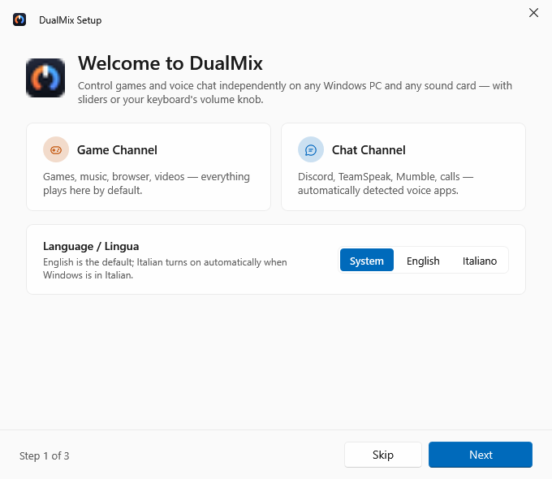
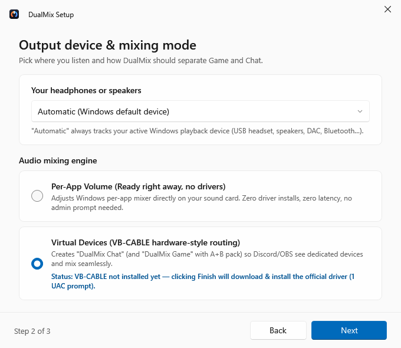
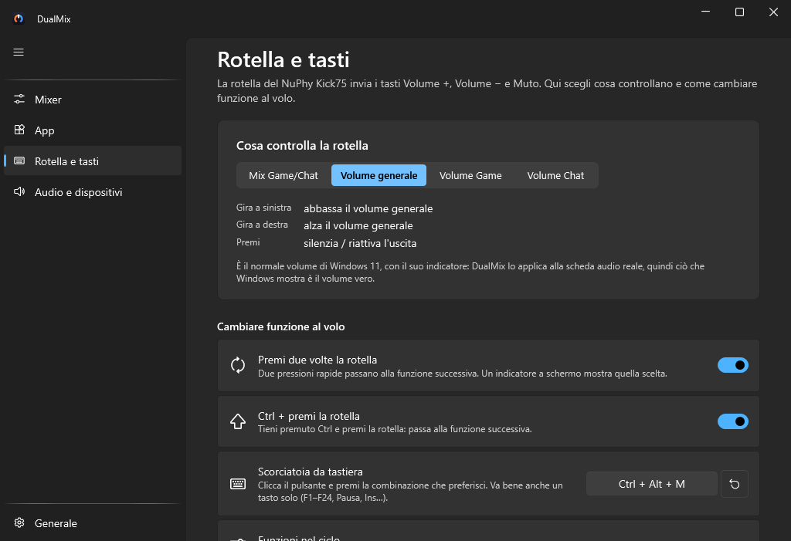
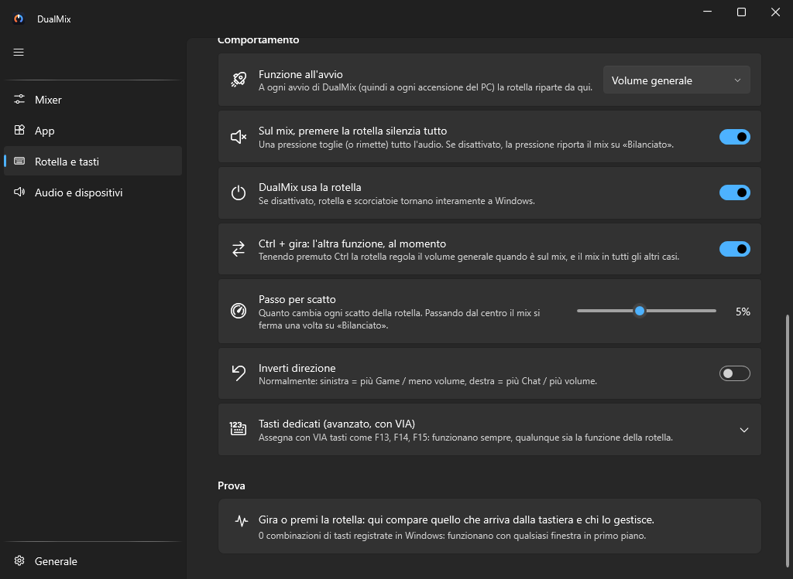
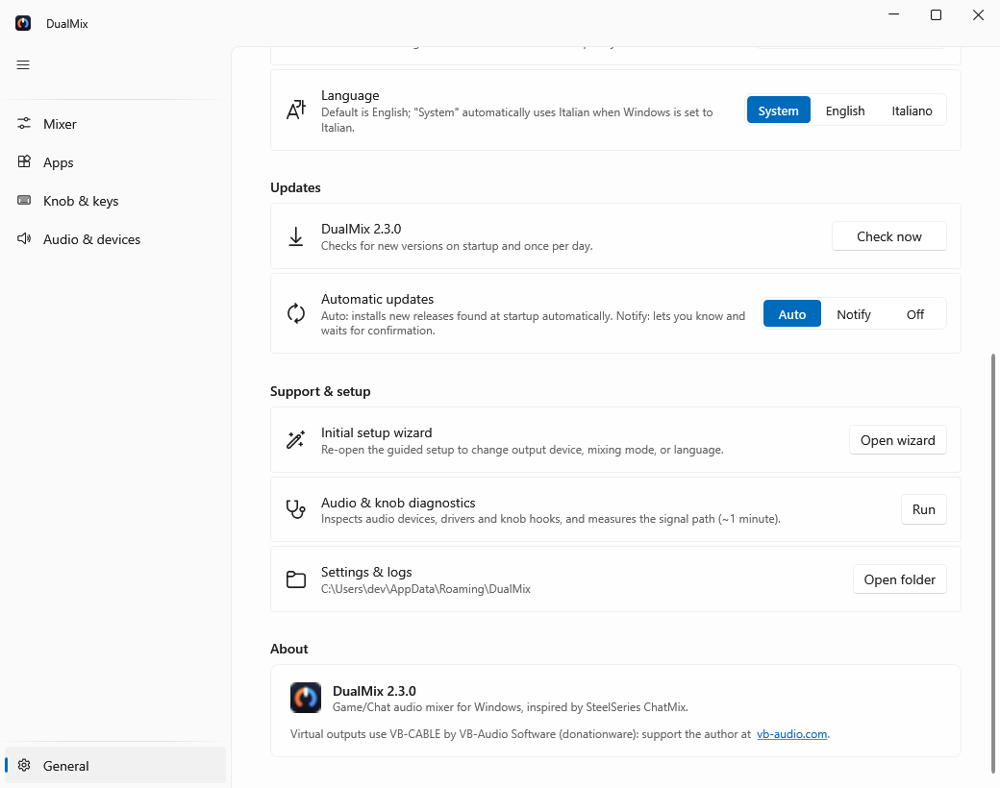

<p align="center">
  
</p>

<p align="center">
  <a href="https://github.com/gamebaiters/dualmix/releases"></a>
  <a href="https://github.com/gamebaiters/dualmix/actions/workflows/build.yml"></a>
  
  
  <a href="LICENSE"></a>
</p>

**DualMix** is a universal **Game / Chat audio mixer** for **Windows 10 / 11** inspired by SteelSeries Sonar / GameDAC *ChatMix*.
It works out of the box on **any PC and any playback device** (USB DACs, headsets, Realtek onboard audio, Bluetooth headphones, or dedicated sound cards), automatically separates games/media (**Game**) from Discord, TeamSpeak, and voice calls (**Chat**), and lets you balance them on the fly using your **keyboard volume knob** or global hotkeys—without ever alt-tabbing out of your game.

- **Works immediately with zero drivers** in **Per-App Volume** mode, or upgrades seamlessly to **Virtual Devices (VB-CABLE A+B)** with a 32-bit float WASAPI engine and 160-tap sinc resampler.
- **Guided 3-step Setup Wizard** on first launch picks your output device, mixing mode, and knob behavior in under a minute.
- **English by default**, automatically switching to **Italian** when the Windows UI language is Italian (plus an instant switcher inside the app).

---

## Quick Start & Guided Setup

Download the latest release from [**Releases**](https://github.com/gamebaiters/dualmix/releases/latest):

1. **Graphical Installer (`DualMix-Setup-<v>.exe`)** — double-click and install. No administrator rights required.
2. **Portable ZIP Package (`DualMix-<v>-win-x64.zip`)** — extract and run **`Install DualMix.cmd`** (useful if Windows SmartScreen or antivirus flags the unsigned `.exe`; runs the exact same setup script).

What the installer (`packaging/setup/setup.ps1`) does:
- Ships as a **standalone native executable (`DualMix.exe`, ~1.5 MB)** with **zero runtime dependencies** (no .NET installation needed).
- Cleanly shuts down any running DualMix instance, uninstalls/replaces older versions (including legacy source builds and v2.x .NET installs), and **keeps your settings and virtual cables intact**.
- Installs to `%LOCALAPPDATA%\Programs\DualMix`, adds a Start menu shortcut and a standard **Installed apps** entry, then launches DualMix.
- Logs every setup step in `%APPDATA%\DualMix\setup.log`.

| Utility | Purpose |
|---|---|
| **`Remove-old-DualMix.zip`** → `Remove old DualMix.cmd` | Standalone cleanup script for legacy manual installs (up to v2.1.0), keeping settings and virtual cables intact. |
| **`Uninstall DualMix.cmd`** (or *Settings → Apps → DualMix*) | Full uninstall. Supports `-RemoveDrivers` (also uninstalls virtual cables) and `-Purge` (deletes settings and logs). |

### First-Launch Setup Wizard

On first launch, DualMix opens a guided 3-step Setup Wizard (also re-openable anytime from **General → Initial setup wizard**):

1. **Language & Welcome** — Defaults to English (or Italian automatically when Windows UI is Italian), with an instant live preview switch.
2. **Playback Output & Mixing Mode** — Auto-detects your active Windows speakers/headphones/DAC and lets you choose between:
   - **Per-App Volume (No Drivers)** — Starts immediately without admin rights or audio drivers by scaling each app's WASAPI session volume.
   - **Virtual Devices (VB-CABLE A+B)** — Uses two dedicated virtual outputs (*DualMix Game* & *DualMix Chat*) mixed through DualMix's 32-bit float loopback engine (includes one-click verified driver install).
3. **Knob Rules & Windows Integration** — Sets startup knob behavior, optional autostart with Windows, and disables Windows automatic 80% call ducking.

<p align="center">
  
  
</p>

---

## Audio Architecture

In **Virtual Devices** mode, DualMix routes applications onto two virtual playback endpoints (**DualMix Game** and **DualMix Chat**), captures both streams in 32-bit float via **WASAPI Loopback**, compensates clock drift between devices using a **160-tap Kaiser-windowed sinc resampler** (SNR > 130 dB, bit-exact at 1:1 ratio), and mixes them into your chosen physical output device. On any PC without virtual cables—or whenever you prefer zero extra drivers—DualMix runs cleanly in **Per-App Volume** mode via Windows WASAPI session controls.

<p align="center">
  
</p>

---

## Interface Overview

### 1. Mixer
Live **Game / Chat Mix** slider with one-click presets (*All Game*, *Balanced*, *All Chat*), independent **Game** and **Chat** channel meters and faders, direct master volume control for your physical output device, and engine status chips.

<p align="center">
  
</p>

### 2. Apps — Automatic Channel Assignment
Applications appear automatically as soon as they produce sound:
- **Voice Chat apps** (`Discord`, `TeamSpeak`, `Mumble`, etc.) are automatically recognized and assigned to **Chat**.
- Everything else (games, browsers, media players) defaults to **Game**.
- Switch any app between **Game**, **Chat**, or **Direct** (bypasses virtual routing completely with 0 ms added latency), filter the list, toggle inactive apps, or pre-configure executables before launching them.

<p align="center">
  
</p>

---

## Keyboard Knob, Hotkeys & On-Screen Display (OSD)

DualMix intercepts media keys (`Volume Up`, `Volume Down`, `Mute`, e.g., rotary knobs on keyboards like NuPhy Kick75 or any media keyboard) via `RegisterHotKey` + low-level keyboard hook, reverting any OS volume drift even inside fullscreen games.

<p align="center">
  
</p>

| Function | Rotate | Single Press |
|---|---|---|
| **Master Volume** *(default at PC startup)* | Adjusts real Windows volume on your output device | Mute / Unmute output |
| **Game / Chat Mix** | Left → louder Game · Right → louder Chat *(center detent at Balanced)* | **Mute everything** *(optional setting: snap to Balanced)* |
| **Game Volume** | Adjusts Game channel level only | Mute / Unmute Game |
| **Chat Volume** | Adjusts Chat channel level only | Mute / Unmute Chat |

- **Cycle function on the fly**: double-press the knob, **Ctrl + Press**, or global hotkey (`Ctrl + Alt + M`, falling back automatically to `K`, `R`, or `F12` if occupied).
- **Ctrl + Rotate**: temporarily controls the alternate primary function (*Mix* ↔ *Master Volume*).
- **Dedicated QMK / VIA keys**: bind `F13`, `F14`, `F15` directly to *More Game*, *More Chat*, and *Balanced*.
- **Startup default**: resets cleanly to **Master Volume** at every Windows sign-in (customizable under *Knob & Keys → Behavior → Function at startup*).

<p align="center">
  
  
</p>

### Windows 11-style On-Screen Display (OSD)
Turning or pressing the knob pops up a lightweight floating indicator on your active monitor:
- **`WS_EX_NOACTIVATE` + `WS_EX_TRANSPARENT`**: never steals focus from fullscreen games and lets mouse clicks pass straight through.
- **Clean teardown**: hides the window completely at the end of fade-out (with safety timers and display-change handling) so no gray artifact rectangle ever stays behind.

<p align="center">
  
</p>

---

## Audio Devices, Latency & General Settings

- **Universal Playback Selection**: choose **Automatic** (follows your active Windows speakers/headphones/DAC) or pin a specific physical output device. DualMix filters out virtual cables automatically to prevent feedback loops.
- **VB-CABLE A+B Setup**: optional one-click install/repair with digital signature verification, automatic sample rate & channel layout matching (`DualMix Game` + `DualMix Chat`), **Direct Games** toggle, and latency profiles (*Minimum*, *Balanced*, *Safe*).
- **Language Switcher**: automatic English/Italian detection (`System (auto)`) plus manual **English** / **Italiano** override under *General → Language*.
- **Call Ducking Protection**: disables Windows' automatic 80% volume reduction during VoIP calls.

<p align="center">
  
  
</p>

<p align="center">
  
  
</p>

---

## Auto-Builder & Automatic Updates

DualMix ships with both a **GitHub Actions CI/Release pipeline** and a built-in **SHA-256 Auto-Updater** inspired by *RP Soundboard*: a lightweight `version.json` manifest on `main` advertises the latest release version, HTTPS package URL, and **SHA-256** digest.

<p align="center">
  
</p>

- **Update Checks**: 1 minute after launch and every 24 hours (or immediately via *Check now*).
- **Update Modes**:
  - **Automatic** *(default)*: downloads and verifies **SHA-256** on startup, runs `setup.ps1 -Update` in the background, and relaunches DualMix cleanly; if detected mid-session (while gaming), notifies first and waits for the next launch.
  - **Notify only**: informs you when a new version is available without auto-installing.
  - **Never**: disables background checks.
- **Custom Update Feed**: override `UpdateFeed` in `%APPDATA%\DualMix\settings.json` to point to a custom `https://` feed or a shared local/Nextcloud folder containing `version.json` and the ZIP package.

---

## Building from Source & Releasing

### Repository Structure

```text
DualMix/
├── dualmix-rs/                  Native Rust workspace (win-x64, LTO single binary)
│   ├── crates/dualmix-core/     DSP (160-tap sinc resampler, SPSC ring), settings, rules, loc (EN/IT)
│   ├── crates/dualmix-audio/    WASAPI AudioRouter, SessionEngine, IPolicyConfig, AudioPolicyConfig, DriverSetup
│   ├── crates/dualmix-input/    KeyboardHook (RegisterHotKey + WH_KEYBOARD_LL), KnobController
│   ├── crates/dualmix-ui/       Win32 GDI+ OSD, Shell_NotifyIconW Tray, Fluent 2 WebView2 UI
│   └── crates/dualmix-app/      DualMix.exe entry point, Controller, Supervisor, Updater, --diag
├── DualMix/                     Legacy .NET 10 WPF source (reference / v2.3.0)
├── packaging/
│   ├── setup/                   setup.ps1, uninstall.ps1, rimuovi-vecchio.ps1 (auto EN/IT)
│   ├── installer.nsi            NSIS installer script (English + Italian language tables)
│   └── *.cmd / README.txt       Portable user launchers & docs
├── tools/
│   ├── build-release.sh         Release builder (ZIP + NSIS + version.json + SHA256SUMS)
│   ├── make_icon.py             Multi-size icon generator (Pillow)
│   └── rilascia.sh              Local release + Nextcloud deployment script
├── .github/workflows/
│   ├── build.yml                CI on push/PR (Rust tests/build, PowerShell parser check, NSIS & ZIP)
│   └── release.yml              Auto-builder on vX.Y.Z tag push -> GitHub Release + version.json commit
├── docs/images/                 Architecture diagrams, banner, and screenshots
├── install.ps1                  Build from source on Windows & install via setup.ps1
└── LICENSE                      MIT License
```

### Build from Source

- **On Windows** (requires [Rust MSVC toolchain](https://rustup.rs)):
  ```powershell
  # Build Release and install to %LOCALAPPDATA%\Programs\DualMix
  powershell -ExecutionPolicy Bypass -File install.ps1

  # Or build only
  cargo build --manifest-path dualmix-rs/Cargo.toml --release
  ```
- **On Linux / CI** (cross-builds / packages ZIP + NSIS + `version.json`):
  ```bash
  tools/build-release.sh --exe path/to/DualMix.exe --notes "Release notes summary"
  # Output in out/release/: DualMix-<v>-win-x64.zip, DualMix-Setup-<v>.exe, Remove-old-DualMix.zip, version.json, SHA256SUMS.txt
  ```

### Publishing a New Release (Auto-Builder)

1. Bump `version = "X.Y.Z"` in `dualmix-rs/Cargo.toml` and commit to `main`.
2. Create and push an annotated version tag:
   ```bash
   git tag -a vX.Y.Z -m "Short summary of what changed"
   git push origin main --tags
   ```
3. [`.github/workflows/release.yml`](.github/workflows/release.yml) automatically builds all artifacts, publishes the **GitHub Release** `vX.Y.Z`, and commits the updated `version.json` to `main` so existing installations pick up the update automatically.

### Built-in CLI Tools

- `DualMix.exe --diag [--quick] [--stress]` — runs audio/math/hook diagnostics and writes `%APPDATA%\DualMix\diag.txt`.
- `DualMix.exe --wizard` — launches the 3-step Setup Wizard directly.
- `DualMix.exe --lang en|it` — overrides UI language for testing (`auto`, `en`, `it`).
- `DualMix.exe --snapshot <folder>` — captures PNG screenshots of the Setup Wizard and all UI pages cleanly without touching audio devices.
- Application logs: `%APPDATA%\DualMix\dualmix.log`.

---

## License & Credits

- Released under the [**MIT License**](LICENSE).
- Optional virtual audio routing uses [**VB-CABLE**](https://vb-audio.com/Cable/) by VB-Audio Software (donationware).
- Built in native **Rust** with `windows-rs`, **WebView2**, and **WASAPI**.
